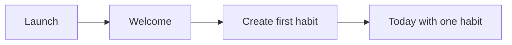

# <App name>: Structure

## Objects and actions
| Object | Actions | Contains / belongs to |
|---|---|---|
| <Habit> | <create, edit, archive, reorder, check off, skip> | <belongs to Day log> |

## Screen inventory
| Screen | Purpose | Primary action | Entry points | Platforms | Mode |
|---|---|---|---|---|---|
| <Today> | <see and check off today's habits> | <check off> | <launch, widget, notification> | <all> | Operate |

## Navigation per platform
| Platform | Top level | Hierarchy | Secondary surfaces |
|---|---|---|---|
| iPhone | <tab bar: Today, Stats, Settings> | <NavigationStack> | <sheets (medium/large), context menus> |
| iPad / Duo | <sidebar + split view; postures per ipad-duo-design> | | <inspector> |
| Android | <nav bar → rail (medium) → drawer (expanded)> | <back stack, predictive back> | <bottom sheets> |
| macOS / Windows / Linux / Web | <…> | | |

Deep links / URLs: <which screens are addressable>

## Key flows
### 1. First run

<Intent: what the person should feel and know at the end. Permission requests and when.>

### 2. Core loop
### 3. Create / edit / delete (with undo)
### 4. Find (search, filter, no results)
### 5. Settings and account (sign-out, delete account)
### 6. Failure paths (offline, permission denied, sync conflict)

## State matrix
| Screen | Empty (first use) | Empty (no results) | Loading | Error | Offline | Partial | Overflow | Permission denied |
|---|---|---|---|---|---|---|---|---|
| <Today> | <invite to add a first habit> | n/a | <skeleton rows> | <inline retry banner> | <works; sync queued badge> | | <60-char names wrap to 2 lines; 50 habits scroll> | n/a |
