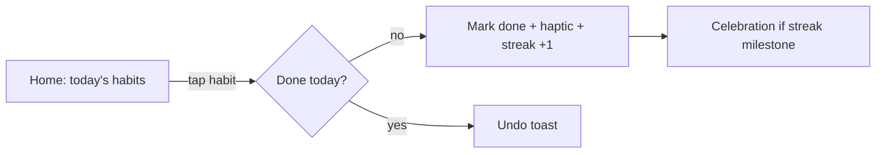

# Phase 2: Structure: IA, navigation, flows, states

Design what exists and how people move before how it looks. Structure mistakes are the most expensive to fix later, because every screen inherits them.

## 1. Objects and actions (the IA)

List the nouns the app manages and the verbs on each. Example for a habit app: *Habit* (create, edit, archive, reorder, check off, skip), *Day* (view, review), *Streak* (view), *Reminder* (set, snooze). Then:
- Which object is primary? That is usually the home screen's subject.
- Which objects contain others (a project contains tasks)? That gives the hierarchy and the list → detail paths.
- Name things the way the person would, not the way the database does ("Reminders", not "Notification schedules").

## 2. Screen inventory

One row per screen, sheet, dialog, popover, window, widget and notification:

| Screen | Purpose (one line) | Primary action | Entry points | Platforms |
|---|---|---|---|---|

Include the unglamorous ones: onboarding, sign-in, permissions priming, empty home, settings, about, account deletion, error pages (404 on web), update-required, widgets, notifications, share sheets, menu bar extras.

## 3. Navigation model per platform

The same IA maps to different chrome per platform. Decide it explicitly; full rules are in each platform file.

| Platform | Top-level navigation | Hierarchy | Secondary |
|---|---|---|---|
| iPhone | Tab bar (3–5 tabs; Liquid Glass on iOS 26+) | `NavigationStack` push | Sheets with detents, menus, context menus |
| iPad | Tab bar that becomes a sidebar, or `NavigationSplitView` | Split view columns | Inspectors, popovers, sheets as forms, multiple windows |
| iPhone Duo | As iPhone closed, as iPad open; see `ipad-duo-design` postures | | |
| Android | Navigation bar (compact), navigation rail (medium), drawer or rail (expanded) | Back stack; predictive back | Bottom sheets, menus, dialogs |
| macOS | Sidebar + toolbar + **menu bar** (every command lives in a menu) | Split views, tabs, multiple windows | Inspector, popovers, sheets, Settings window (⌘,) |
| Windows | `NavigationView` (left pane or top), title bar with tabs where useful | Frames | Flyouts, content dialogs, teaching tips |
| Linux (GNOME) | Header bar + view switcher / sidebar (libadwaita) | Navigation view | Popovers, dialogs, toasts |
| Web | App shell: top bar and/or sidebar; URL is part of navigation | Routes, breadcrumbs | Dialogs, popovers, drawers, command palette |

Rules that apply everywhere:
- Top-level destinations: 3–5 on phones; more goes into a sidebar or "More" grouping, never a crowded bar.
- Every screen has an obvious way back, and back behaves predictably (system back on Android, swipe-back on iOS, browser back and deep links on web).
- Deep links: decide which screens are addressable (URLs, universal/app links, shortcuts, Spotlight/App Intents).
- Commands are reachable more than one way on desktop: menu, toolbar or button, keyboard shortcut, context menu.

## 4. Flows

For each key flow write numbered steps with decision points, as Mermaid plus a short prose note on intent. Minimum set:
1. **First run**: from install to the first moment of value. Keep it short; ask for permissions just before the feature that needs them, with a reason.
2. **The core loop**: the thing people do every day. Count taps/clicks; remove every one you can.
3. **Create / edit / delete**: with validation, unsaved-changes handling, and **undo** (prefer undo over confirmation dialogs for reversible actions).
4. **Find**: search, filter, sort, and what happens with no results.
5. **Settings and account**: including sign-out and account deletion (required on the App Store).
6. **Failure paths**: offline, timeout, permission denied, sync conflict, payment failure. Each ends somewhere useful.

Render the diagrams for the checkpoint (a browser can render Mermaid; so can most design tools).

## 5. The state matrix

Every screen that shows data gets a row; each cell names what the person sees and can do. Untouched states are where builders improvise, so the design must fill them.

| Screen | Empty (first use) | Empty (no results) | Loading (first / refresh / more) | Error | Offline | Partial / degraded | Overflow | Permission denied |
|---|---|---|---|---|---|---|---|---|

Guidance:
- **Empty** is an invitation to act: say what goes here and offer the action that fills it. First-use empty differs from no-results empty (which offers to clear filters).
- **Loading**: skeletons that match the final layout for content; spinners only for short, indeterminate actions; never block the whole screen for a background refresh. Keep previous content visible while refreshing.
- **Error**: say what happened, in the person's terms, and the way out (retry, edit, go offline). Inline for validation, near the field.
- **Offline**: what still works, what's queued, how the person knows.
- **Overflow**: truncation rules, wrapping, counts like "99+", very long names, huge numbers, many tags.

Checkpoint: rendered flow diagrams, the screen inventory and the navigation model per platform.
